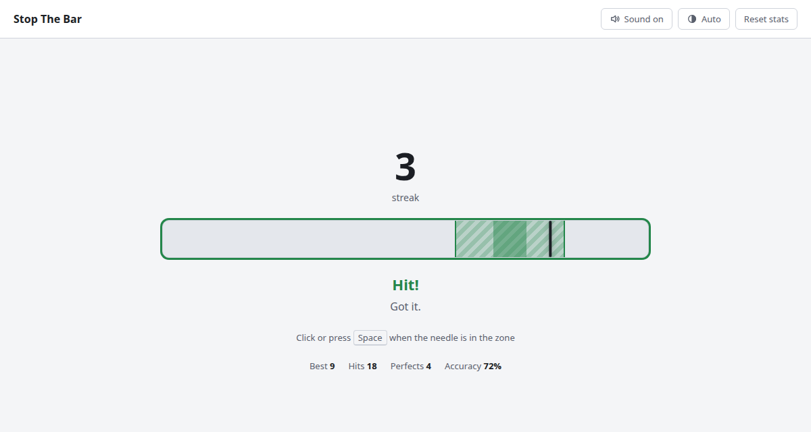

# Stop The Bar

A silly one-button timing game for short breaks.

A needle sweeps across a bar: stop it inside the green zone. Every hit shrinks
the zone and speeds the needle up; a miss sends your streak back to zero. There
is no game over and nothing to finish, so you can close the tab at any moment.



## How to play

- Click, tap or press <kbd>Space</kbd> when the needle is in the zone.
- Stopping it in the darker middle of the zone is a perfect.
- Streak, best, hits and accuracy are kept in your browser. **Reset stats** clears them.
- The theme follows your system; the theme button switches between Auto, Light and Dark.

## Development

Requires Node 24.

```sh
npm install
npm run dev      # dev server on http://localhost:5173
npm run check    # lint, type check and tests
npm run build    # static site in dist/
```

To try it on a phone, run `npm run dev -- --host` and open the Network URL from
a device on the same network.

| File | What's in it |
|---|---|
| `src/game.ts` | The rules: needle motion, judging a press, difficulty curve. No DOM, unit-tested. |
| `src/stats.ts`, `src/storage.ts` | Stats and the `localStorage` save, validated on load. |
| `src/main.ts` | DOM, input and the animation loop. |
| `src/sound.ts`, `src/quips.ts` | Beeps and one-liners. |

The needle's position is computed from time, and a press is judged at the
event's own timestamp rather than at the next animation frame, so input lag
doesn't move the needle after you've pressed.

## Docker

```sh
docker build -t stop-the-bar .
docker run --rm --read-only --tmpfs /tmp -p 8080:8080 stop-the-bar
```

Every `vX.Y.Z` tag publishes `ghcr.io/ophusdev/stop-the-bar` for `linux/amd64`
and `linux/arm64`. The container:

- serves plain HTTP on port 8080 as a non-root user, so TLS belongs in front of it;
- needs no environment variables, volumes or secrets;
- runs with a read-only root filesystem, given a writable `/tmp`;
- answers `GET /healthz` with `204`;
- sends a strict Content Security Policy and caches hashed assets for a year.

## Releasing

```sh
npm version minor -m "chore(release): %s"   # bumps package.json, commits, tags vX.Y.Z
git push --follow-tags
```

## License

[MIT](LICENSE)
